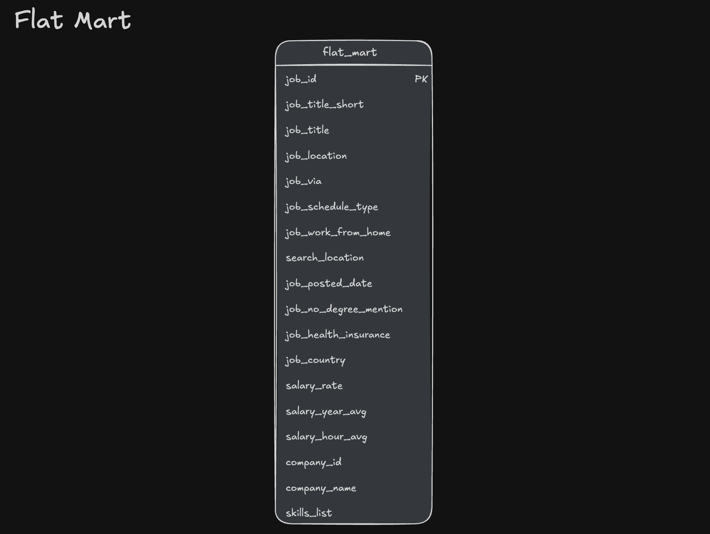

# Data Warehouse and Data Marts

A SQL data engineering project that loads job-posting data into a DuckDB data warehouse and builds analytical data marts for job, skill, and priority-role analysis.

## Architecture

The pipeline moves data from CSV sources into the warehouse, transforms it into data marts, and makes those marts available to downstream tools.


## Data warehouse

The warehouse uses a fact-and-dimension model. Job postings are stored in `job_postings_fact` and connect to company, skill, and job-skill tables.


## Data marts

### Flat mart

`flat_mart.job_postings` combines job-posting, company, and skill information into a denormalized table for analysis.



### Skills mart

The skills mart organizes skills and months into dimensions and summarizes monthly skill demand by job title. Its measures include posting counts, remote postings, postings with health insurance, and postings that do not mention a degree requirement.


### Priority mart

The priority mart stores role priorities in `priority_mart.priority_role` and maintains a job snapshot in `priority_mart.priority_jobs_snapshot`.


## Build the project

Requirements:

- DuckDB CLI
- Internet access to load the source CSV files from Google Cloud Storage

From the repository root in PowerShell, run:

```powershell
Set-Location .\2_DW_Mart_Build
duckdb ..\dw_marts.duckdb -c ".read build_dw_marts.sql"
```

The command opens the local `dw_marts.duckdb` file (without the `md:` prefix) and runs the SQL scripts in order:

1. Create the warehouse tables.
2. Load the CSV data.
3. Build the flat mart.
4. Build the skills mart.
5. Create the priority mart.
6. Update the priority roles and refresh the priority-job snapshot.

> **Warning:** This is a full rebuild. The scripts drop and recreate warehouse tables and mart schemas. Back up any database data you want to keep before running them.

## Main SQL files

| File | Purpose |
| --- | --- |
| `01_create_tables_dw.sql` | Creates the warehouse tables. |
| `02_load_schema_dw.sql` | Loads source data into the warehouse. |
| `03_create_flat_mart.sql` | Builds the flat job-postings mart. |
| `04_create_skills_mart.sql` | Builds the monthly skills-demand mart. |
| `05_create_priority_mart.sql` | Creates the priority roles and job snapshot. |
| `06_update_priority_mart.sql` | Updates role priorities and refreshes the snapshot. |
| `build_dw_marts.sql` | Runs the build scripts in sequence. |
